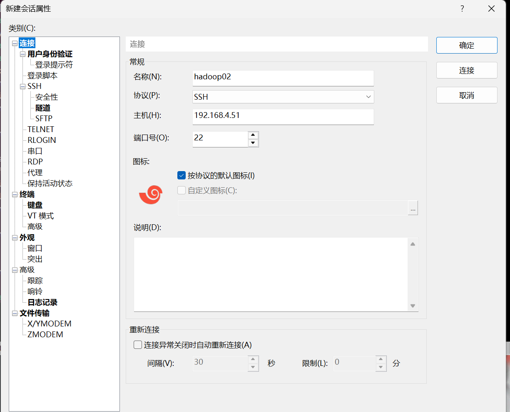
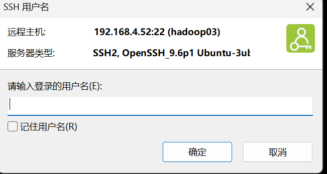
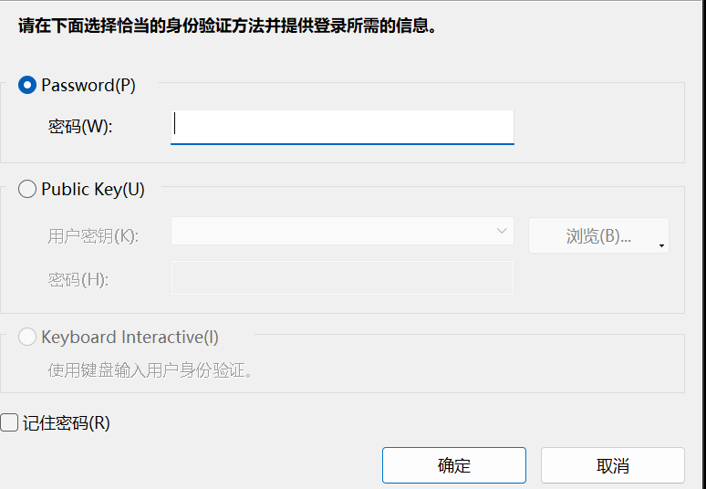

# 基本命令
1. `mkdir` 新建文件夹 make directory
2. `ls` 列出当前目录内容 list
3. `pwd` = print working directory 展示当前工作文件夹
4. `cd` = change directory 
5. `cp` = copy
6. `mv` = move
7. `rm` = remove
	- **`-r`**（或 `--recursive`）：表示递归删除。如果 `newinput` 是一个目录，该选项会删除该目录及其内部的所有子目录和文件。
	- **`-f`**（或 `--force`）：表示强制删除。它会忽略不存在的文件，并且**不会提示确认**，即使文件是只读的也会被直接删除。
8. `rmdir 目录名` ：删除空目录
9. `cat` = concatenate (连接)  在终端显示文本内容
10. `tail -n 2 file` 显示文件末尾
11. `touch` 新建文件
12. `vim`生成Makefile 文件
13. 保存`Makefile`步骤如下：
14. `stat -c "%a %n" 文件地址`：查看文件权限，八进制
15. `apt`：管理系统级软件包（如 Git、Vim、Nginx、Python 本身等）
16. `cat`：concatenate，将多个文件连起来输出，现在常用来查看配置文件
17. `sudo chmod 777 module`：修改module文件的权限
	- `777`是权限的八进制表示法，每一位分别代表：
    - 第一个 `7`：所有者（owner） 的权限
    - 第二个 `7`：所属组（group） 的权限
    - 第三个 `7`：其他用户（others） 的权限
	- 数字 `7` 对应二进制 `111`，即 **读 + 写 + 执行**（rwx）权限。

    1. 按 `i` 键进入插入模式 (Insert Mode)**，此时可以编辑文本。
    2. 输入完内容后，**按 `Esc` 键**退出插入模式，回到**正常模式 (Normal Mode)**。
    3. 输入冒号 `:`，进入**命令行模式 (Command-Line Mode)**，光标会跳到窗口底部。
    4. 输入 `wq`，然后**按 `Enter` 键**。
       - `w` 代表 **write** (保存)
       - `q` 代表 **quit** (退出)
       - 组合 `:wq` 就是“保存并退出”。

    **口诀：`i` (编辑) -> `Esc` (退出编辑) -> `:wq` (保存退出) -> `Enter` (执行)。**

    **(可选) 如果不想保存，直接退出**：按 `Esc` 后，输入 `:q!` 然后按 `Enter`（强制退出不保存）。

18. C++文件

    ```bash
    gcc -E hello.c -o hello.i # 预处理
    gcc -S hello.i -o hello.s # 编译
    gcc -c hello.s -o hello.o # 汇编
    gcc hello.o -o hello # 链接
    ./a.out #运行
    ```
    
    **预处理**过程做了什么：
    
    1. 展开所有的宏定义（`#define`）。
    2. 处理所有的条件预编译指令（如 `#if`, `#ifdef`）。
    3. 递归地包含（`#include`）所指明的头文件（如 `stdio.h`），将其内容直接插入到 `.i` 文件中。
    4. 删除所有的注释 `//` 和 `/* ... */`。
    5. 结果：生成一个经过预处理后的源代码文件** (`hello.i`)。你可以用文本编辑器打开它看看，会发现文件变得非常大，因为 `stdio.h` 等头文件的内容都被包含了进来，但你的 `main` 函数代码还在最后。

# 内核模块

```bash
make # 编译
sudo insmod helloworld.ko # 装载模块
dmesg  # 查看控制台输出
lsmod # 查看模块
lsmod | grep 文件名 #查看指定模块
sudo rmmod helloworld  # 卸载模块
```

# 文件结构
```
/etc       # 配置文件
/home      # 用户目录
/opt       # 存放大型软件的地方，/opt/google
/usr       # 用户程序和系统软件，/user/bin
/var       # 存放变化的数据，/var/log
/root      # root用户目录
/tmp
```

# 云计算实验课

- 查看主机名：`hostname`
- `sudo gedit /etc/hostname ` 修改机器名
- `sudo vim /etc/hosts`：修改地址映射

- 查看防火墙状态：`sudo ufw status  `

   打开防火墙：`sudo ufw enable  `

   关闭防火墙：`sudo ufw disable`

 - ```bash
   cd /usr
   rz # 上传文件
   nohup java -jar smxz-0.0.1-SNAPSHOT.jar > Log.log 2>&1 & # 挂在后台
   jobs # 查看后台运行的任务 
   jps # 查看java项目的PID号
   kill -9 PID号 # 使用kill杀死进程，中断java程序
   ```

- `ipconfig -a` ：查看该虚拟机的ip地址

rsync 远程同步工具，rsync 主要用于备份和镜像。具有速度快、避免复制相同内容 和支持符号链接的优点。 rsync 和 scp 区别：用 rsync 做文件的复制要比 scp 的速度快，rsync 只对差异文 件做更新。scp 是把所有文件都复制过去。

`scp -r $pdir/$fname $user@$host:$pdir/$fname`

| 部分                         | 说明                                                           |
| -------------------------- | ------------------------------------------------------------ |
| `$pdir/$fname`             | 要拷贝的源文件或目录路径（本地）                                             |
| `$user@$host:$pdir/$fname` | 目标地址：`$user` 是远程用户名，`$host` 是远程主机名/IP，`$pdir/$fname` 是远程目标路径 |

| 部分                         | 说明                                                           |
| -------------------------- | ------------------------------------------------------------ |
| `scp`                      | 安全复制命令（Secure Copy），用于在本地与远程主机之间传输文件或目录                      |
| `-r`                       | 递归选项，表示复制整个目录及其子目录和文件                                        |


| 部分                         | 说明                                                                                                                                                                             |
| -------------------------- | ------------------------------------------------------------------------------------------------------------------------------------------------------------------------------ |
| `rsync`                    | 远程同步工具，支持增量备份、高效传输                                                                                                                                                             |
| `-a`                       | 归档模式（archive mode），等价于 `-rlptgoD`，表示：<br>• 递归复制 (`-r`) <br>• 保留符号链接 (`-l`) <br>• 保留权限 (`-p`) <br>• 保留时间戳 (`-t`) <br>• 保留组信息 (`-g`) <br>• 保留所有者 (`-o`) <br>• 保留设备文件和特殊文件 (`-D`) |
| `-v`                       | 显示详细输出（verbose），可看到复制过程中的文件列表                                                                                                                                                  |
| `$pdir/$fname`             | 源文件或目录路径（本地）                                                                                                                                                                   |
| `$user@$host:$pdir/$fname` | 远程目标路径                                                                                                                                                                         |


# Xshell控制VMware

> VMware原生图形界面很卡，而且如果开了多台虚拟机，来回切换需要重新点击屏幕（未在工作界面的虚拟处于待机状态），切换延迟也很大！！！
> 内存刺客，开三台虚拟机，加一些其他日常工作界面就卡爆炸了
> 而且对于Linux虚拟机习惯用命令行去解决

## 一、配置网络适配器
首先进入虚拟网络编辑器，配置VMnet8文件
使用NAT模式

| 项目    | 值                             |
| ----- | ----------------------------- |
| 子网IP  | 192.168.4.0                   |
| 子网掩码  | 255.255.255.0                 |
| DHCP池 | 192.168.4.128 - 192.168.4.254 |

配置虚拟机的网络适配器为VMnet8

## 二、配置静态IP

由于虚拟网路IP地址是靠DHCP动态分配的，用Xshell连接只能使用静态IP地址。不然每次重启虚拟机都需要重新配置Xshell。
这里使用Netplan，编辑其配置文件
```bash
sudo vim /etc/netplan/00-installer-config.yaml
```

注意静态IP的配置需要避免在DHCP管理的范围内
```yaml
network:
  ethernets:
    ens33:               # 网卡名（用 `ip a` 查看）
      dhcp4: no
      addresses:
        - 192.168.4.50/24  
      routes:
        - to: default
          via: 192.168.10.2
      nameservers:
          addresses: [8.8.8.8, 114.114.114.114]
  version: 2
```
- dhcp4：禁用
- addressses：静态IP和子网掩码
- routes-via：网关IP
- nameservers：配置DNS服务器地址
	- `8.8.8.8` 是 Google 的公共 DNS。
	- `114.114.114.114` 是中国国内常用的公共 DNS（由 CNNIC 提供）。
- version2：Netplan v2 版本

修改文件权限，只有root可读写，直接应用配置文件会报错
```bash
sudo chmod 600 /etc/netplan/00-installer-config.yaml
```

应用配置文件
```bash
sudo netplan apply
```

验证en33下的ip是否已经成功更改
```bash
ip a 
```

也可以在本地主机上ping虚拟机的ip地址

## 三、配置Xshell

### 1.新建会话关系
首次配置的时候需要输入虚拟机的用户名，和密码。

- 名称就是Xshell里的名字
- 主机就是ip地址

### 2.登录账户



- 这里填写虚拟机的用户名
- 勾选记住用户名（懒）😇

- 可以选择虚拟机的密码登录
- 或者配置了SSH后的密钥登录
- 勾选记住密码（懒）😇

