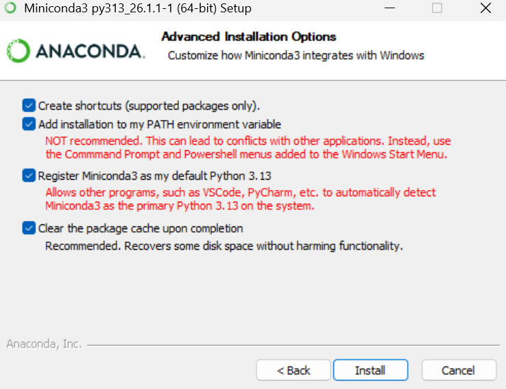

> - conda的优势。都是包管理工具
> - 同项目可能依赖不同版本的库（比如项目A需要 pandas 1.5，项目B需要 pandas 2.2）。
> - 使用 conda 环境，每个项目可以拥有自己独立的 Python 解释器和包集合，互不干扰。如：Python3和Python2的不兼容问题
> - 可以创建不同的虚拟环境
> - pip只能管理py包

# 安装
[Index of /anaconda/miniconda/ | 清华大学开源软件镜像站 | Tsinghua Open Source Mirror](https://mirrors.tuna.tsinghua.edu.cn/anaconda/miniconda/?C=M&O=D)
下载`latest`版本


**全选**

### 加入环境变量
`E:\miniconda3\condabin`

### 验证
`conda --version`

### 配置清华镜像源

   ```bash
   conda config --show channels	# 查看源
   conda config --remove-key channels	#删除源
   
   #添加镜像源
   conda config --add channels https://mirrors.tuna.tsinghua.edu.cn/anaconda/pkgs/main
   conda config --add channels https://mirrors.tuna.tsinghua.edu.cn/anaconda/pkgs/free
   conda config --add channels https://mirrors.tuna.tsinghua.edu.cn/anaconda/pkgs/r
   conda config --add channels https://mirrors.tuna.tsinghua.edu.cn/anaconda/pkgs/pro
   conda config --add channels https://mirrors.tuna.tsinghua.edu.cn/anaconda/pkgs/msys2
   
   #终端显示包从哪个channel下载，以及下载地址是什么
   conda config --set show_channel_urls yes
   ```


# conda环境常用命令

包安装命令

>使用 conda 和 pip，管理py包，会将包安装到虚拟环境位置。如果是其他管理工具，如npm，会将包安装到当前工作文件夹

   ```bash
   conda install pytorch torchvision torchaudio pytorch-cuda=12.1 -c pytorch -c nvidia	#GPU加速深度学习
   ```

   1. `conda create --name yourname python=3.12` ：创建虚拟环境
   2. `conda env list` ：查看已安装环境
   3. `conda env remove -n jupyter_learn`： 删除已经安装的环境
   4. `activate nzy6053` ：激活虚拟环境，`conda activate jupyter_learn`（Linux命令）
   5. `conda info`：查看当前环境
   6. `conda install` ：安装相关的包，对比pip的好处就是自己下载依赖
   7. `conda list` ：查看当前环境已经安装的包
   8. `conda deactivate` ：退出，一般不用直接退出就好
   9. `Ctrl + C`： 退出`jupyter notebbook` 服务
   
   - `jupyter notebook`：进入网页

