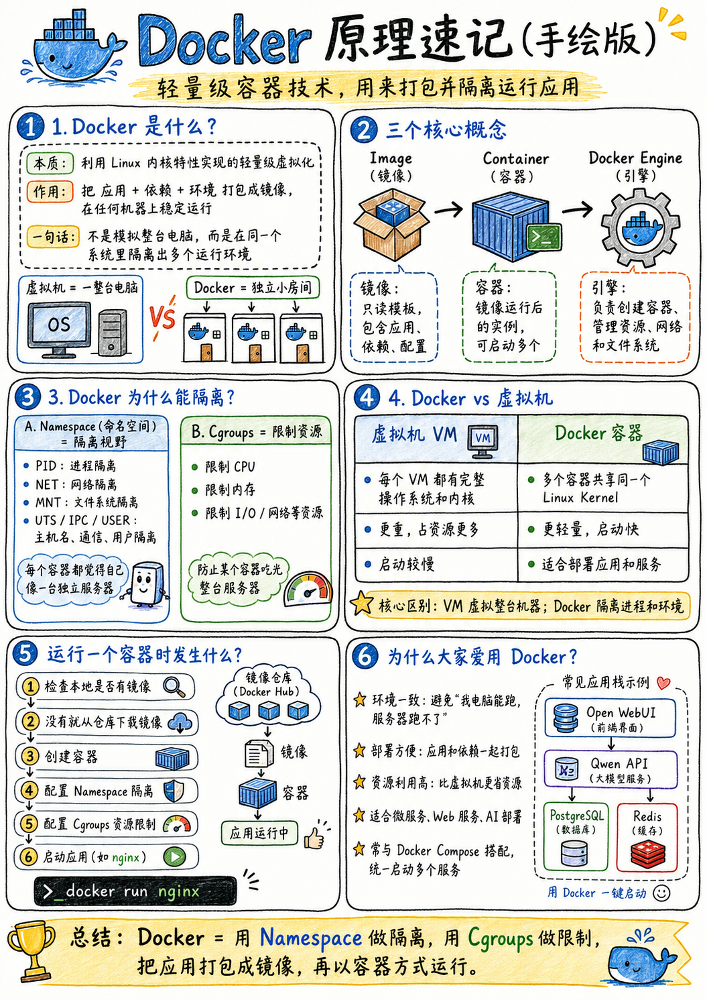

## 一、Docker 介绍

[Docker Explained for Absolute Beginners [2026]](https://www.youtube.com/watch?v=ZZ10b63xnQc)
### Why Docker
1. 包含代码所有的依赖，不需要`install`
2. 比虚拟机更轻量，见下方的 [Docker vs 虚拟机](#1-docker-vs-虚拟机) 小节：CPU、内存、磁盘占用少；启动更快

**注：Docker需要的操作系统(OS)或架构(x86,Arm)是不一样的**
### 1. Docker vs 虚拟机



- 虚拟机：有独立的虚拟操作系统，只能使用被分配的硬件资源
- Docker：使用Docker Engine，所有的Container共享宿主机的操作系统（Linux）和硬件资源，只独立Namespace，包括process,network,mount
	- Docker有自己的文件系统，例如`/bin`里面的工具不通用
	- Docker可以通过`volumn`参数，配置挂载的数据文件
- 当然在虚拟机中使用docker也很常见，比如在VPS中


### 2. Docker Image
```
image
├── Linux 用户空间
├── Python
├── 所需依赖
└── 启动程序
```
- 相当于一个通用的模版，说明这个Docker需要哪些版本的环境，Tools，configs
- [Docker Hub](https://hub.docker.com/)，Docker Image的仓库

### 3.Docker Compose
> 用一个 YAML 文件描述 Hermes 容器应该如何创建、启动、连接和存储数据
> 不需要使用 docker run + 一大堆配置

```bash
docker compose up -d
docker down
```

## 二、从官方安装 Docker 软件

[docs-Docker Engine-install](https://docs.docker.com/engine/install/)
[官方下载源](https://download.docker.com/linux/debian/)
### 1.安装依赖
```bash
sudo apt update
sudo apt install -y ca-certificates curl   # 安装ca和curl两个包，新系统可能没有
```

### 2. 添加Docker官方源
```bash
sudo install -m 0755 -d /etc/apt/keyrings
```
- 创建 Docker 的 keyring 目录，并设置权限

```bash
sudo curl -fsSL https://download.docker.com/linux/debian/gpg \
  -o /etc/apt/keyrings/docker.asc
sudo chmod a+r /etc/apt/keyrings/docker.asc  #设置读取权限
```
- 从 Docker 官网下载 GPG 公钥，并保存到 Debian 的 keyrings 目录
- GPG：GNU Privacy Guard，用于数字签名验证，确保这是Docker发布的没有被篡改

```bash
sudo tee /etc/apt/sources.list.d/docker.sources <<EOF
Types: deb
URIs: https://download.docker.com/linux/debian
Suites: $(. /etc/os-release && echo "$VERSION_CODENAME")
Components: stable
Architectures: $(dpkg --print-architecture)
Signed-By: /etc/apt/keyrings/docker.asc
EOF
```
- 添加 Docker 官方 APT 源
- 这样用apt安装Docker直接走官方仓库


```bash
sudo apt update    # 然后刷新软件源
# download.docker.com/linux/debian trixie
```


### 3. 安装 Docker 组件
```bash
sudo apt install -y \
  docker-ce \
  docker-ce-cli \
  containerd.io \
  docker-buildx-plugin \
  docker-compose-plugin
```

安装完成后先检查服务：
```bash
sudo systemctl status docker  # Active: active (running)
sudo docker run hello-world   # 测试Docker
sudo docker version           # 检查Docker版本
sudo docker compose version
```


## 三、下载image并启动container

```bash
docker pull  镜像名       # 下载镜像
docker run -d\           
--name nginx \           # container NAME
-p 80:80 \
-v 宿主机路径:容器路径 \
镜像名 
```
- Container只监控进程：Container 的生命周期绑定于它启动时的主进程（PID 1）
- 如果其中的服务没有进程（os）或者进程结束（hello-world），container都会自动退出
- `-d`：使container在后台运行，而不占用终端
- `-v 宿主机路径:容器路径`： volume bind mount（目录挂载/映射），把宿主机上的文件映射到容器内，持久化数据，就算删除container，`~/.hermes`这里的文件也不会丢。


## Docker 常用命令

### container相关
#### 查看
```bash 
docker ps -a                  
# >CONTAINER ID    IMAGE    COMMAND    CREATED    STATUS    PORTS    NAME
```
- 查看容器
- 不加`-a`只会显示运行中的

#### 进入容器
```bash
docker attach CONTAINER ID    # 连接主进程
```
- 进入对应的docker
- 其中 CONTAINER ID 只需要提供前几位，与其他不同就行

```bash
docker exec -it NAME bash       # 进入正在运行的进程
```
- `-i`：保持输入通道打开，可以与容器交互
- `-t`：分配一个虚拟终端，容器会产生提示和output
- 如果只是单独的管道输入不需要`-t`
- `bash`：启动shell，或者`bash`命令

#### 停止和删除
```bash
docker stop NAME        
docker rm NAME
```

#### 更新
```bash
cd docker/NAME            # 必须打开compose.yaml所在文件夹位置
docker compose pull
docker compose up -d
```


### image相关
```bash
docker images         # 显示下载的镜像
docker rmi IMAGE      # 必须先删除对应的container
```
