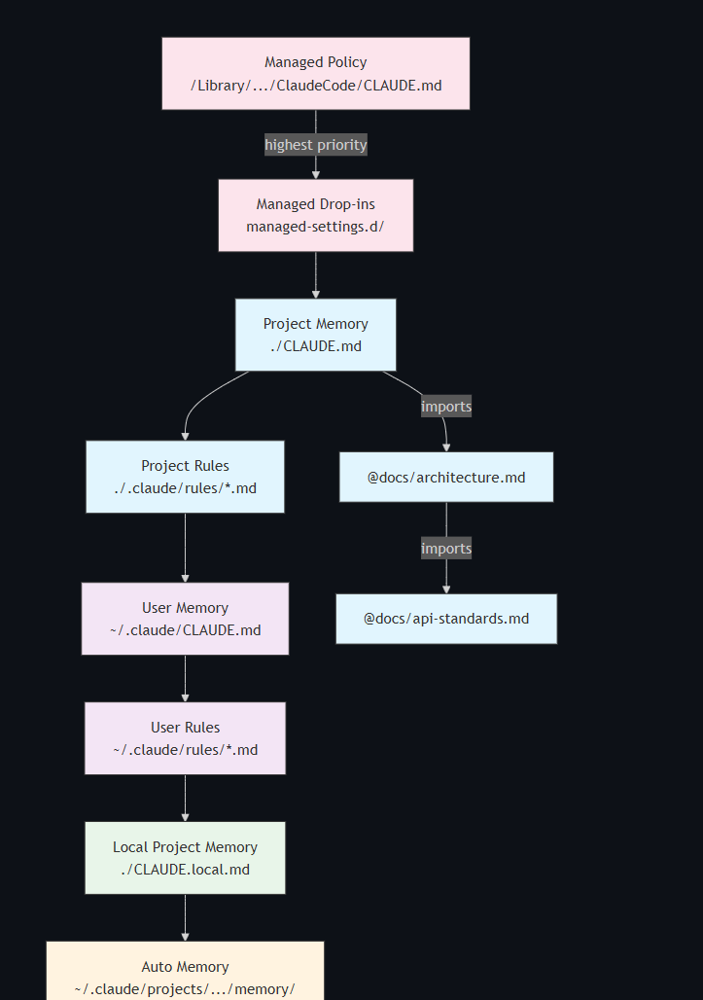

在 `user/.claude/setting.json`文件中编辑配置，接入其他模型
在`user/.claude.json`中配置`"hasCompletedOnboarding": true`这一句可以跳过claude登录

[一个周末学会Claude Code](https://github.com/luongnv89/claude-howto/blob/main/zh/README.md)


## settings.json

| 位置                            | 作用域     |                                        |
| ----------------------------- | ------- | -------------------------------------- |
| `~/.claude/settings.json`     | user    | 否，本地于您的计算机                             |
| `.claude/settings.json`       | project | 是，可以提交到仓库                              |
| `.claude/settings.local.json` | project | 否，gitignored                           |
| `~/.claude.json`              | user    | 存储的是 Claude 与远程服务（如 claude.ai）的认证和会话信息 |


## CLI启动命令
[claude-howto-10](https://github.com/luongnv89/claude-howto/blob/main/zh/10-cli/README.md)

## 快捷键

- `ctrl + O`：查看完整输出
- `shift + Tab`：切换模式`plan mode`或 `edit`模式
- `ctrl + C`：终止流程

## slash command

### /rewind
> 或按两次Esc
1. **Restore code and conversation** -- Revert both files and messages to that checkpoint
2. **Restore conversation** -- Rewind messages only, keep your current code as-is
3. **Restore code** -- Revert file changes only, keep the full conversation history
4. **Summarize from here** -- Compress the conversation from this point forward into an AI-generated summary, freeing context window space. Messages before the selected point stay intact. No files on disk are changed. The original messages are preserved in the session transcript. You can optionally provide instructions to focus the summary on specific topics.
5. **Never mind** -- Cancel and return to the current state


### /init /memory claude.md
> 用于整个工程的标准

在每次对话（conversation）时加载.
例如：
1. 不允许修改database schema
2. 设置coding style

```bash
/init
/memory 
```

/memory的分层，这个slash command一般没啥用，在资源管理器中新建，然后用Typora打开



## skill.md
[官方文档](https://agentskills.io/home)

> 用于特定的任务（task）
>  请求（request）驱动
>  渐进式披露提示词，不占用上下文窗口（context window）

### 分类
skill的四种级别，按优先级递减
```
	- Enterprise: managed-settings.json          
	- Personal: ~/.claude/skills                 # 全局的skill
	- Project: project/.claude/skills 
	- Plugins: project/.claude-plugin/plugin.json
```

### 编写
skill的编写位置
1. 在以上三个位置之一`/skills`
2. 新建skill文件夹
3. 必须是`SKILL.md`
```
user
└── .claude/
    └── skills/
        └── skill-name1/          # 每一个文件夹都是skill 的 name
            ├── SKILL.md          
            ├── scripts/          # Optional: executable code
            │   └── main.py     
            ├── references/       # Optional: documentation
            └── assets/           # Optional: templates, resources
```


```
---
name:
description:
---
prompt指令
```

### 执行流程
1. 当发送一个request，触发skill的调用，会扫描一下几个文件夹，
2. claude 会对比各个skill.md的**metadata**，包括**name和description**，并询问是否使用合适的skill
3. 加载对应的**instructions**进入上下文，**这个时候才会占用context window**
4. 对于其他**resource**按需加载


使用子代理（subagent）的时候，会建立一个干净的context window，并且不会自动读取skill文件，在agent文件夹下面指定读取的skill文件
需要在元数据中声明`context:fork`

## subagents
使用不同的tool，并且和主对话（main conversation）隔离


## hooks
> 事件（event）驱动，百分百触发

1. 指定在”保存文件“时的操作
2. 在调用工具前进行验证

Claude Code 提供 4 类、25 个事件：
- **Tool Hooks**：`PreToolUse`、`PostToolUse`、`PostToolUseFailure`、`PermissionRequest`
- **Session Hooks**：`SessionStart`、`SessionEnd`、`Stop`、`StopFailure`、`SubagentStart`、`SubagentStop`
- **Task Hooks**：`UserPromptSubmit`、`TaskCompleted`、`TaskCreated`、`TeammateIdle`
- **Lifecycle Hooks**：`ConfigChange`、`CwdChanged`、`FileChanged`、`PreCompact`、`PostCompact`、`WorktreeCreate`、`WorktreeRemove`、`Notification`、`InstructionsLoaded`、`Elicitation`、`ElicitationResult`
