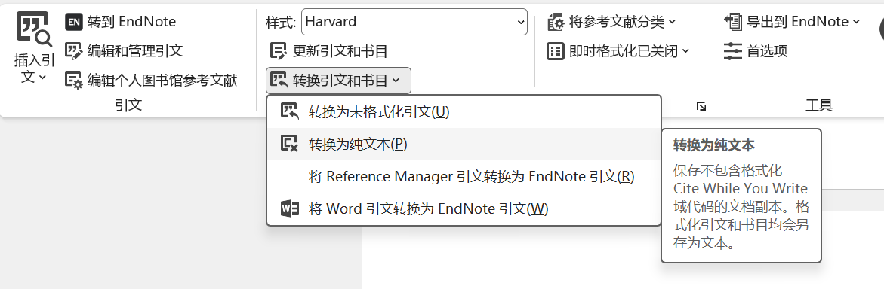

EndNote 无法直接读取 Zotero 的数据库文件，但可以通过**导出-导入**的方式实现文献迁移。最推荐且兼容性最好的方法是使用 **RIS 格式**作为中转。

**.ris**：是通用记录文献格式
### ✅ 推荐方法：通过 RIS 格式中转

#### 第一步：从 Zotero 导出

1. 在 Zotero 中选中需要迁移的文献（可按 `Ctrl+A` 全选）。
2. 右键点击 → 选择 **"导出条目..."**。
3. 格式选择 **"RIS"**。
4. 勾选 **"导出笔记"** 和 **"导出标签"**（根据需要）。
5. 点击 OK，保存为 `.ris` 文件。

#### 第二步：导入 EndNote

1. 打开 EndNote，新建或打开一个现有库。
2. 点击菜单 **File → Import → File...**
3. 关键设置：
    - **Import File:** 选择刚才导出的 `.ris` 文件
    - **Import Option:** 选择 **"Reference Manager (RIS)"** ⚠️ _如果下拉列表中没有此选项，点击 "Other Filters..." 搜索 "RIS" 并勾选_
    - **Duplicates:** 建议选择 "Import All" 或 "Discard Duplicates"
    - **Text Translation:** 选择 **"UTF-8"**（防止中文乱码）
4. 点击 **Import** 即可。

### ⚠️ 重要注意事项

|问题|说明与解决方案|
|:--|:--|
|**PDF 附件丢失**|RIS 格式**不包含** PDF 全文。如需迁移附件，需在 Zotero 中先导出含附件的文件夹，再在 EndNote 中手动批量关联，或使用下文的 BibTeX 替代方案|
|**中文乱码**|务必在导入时 Text Translation 选 **UTF-8**；若仍乱码，尝试用记事本打开 `.ris` 文件另存为 UTF-8 编码后再导入|
|**字段映射偏差**|RIS 是通用格式，部分自定义字段（如 Zotero 的 "Extra" 字段）可能无法完美对应到 EndNote 字段，导入后建议抽查核对|
|**笔记与标签**|RIS 支持笔记和标签导出，但 EndNote 中的显示位置可能与 Zotero 不同，需检查 "Notes" 和 "Keywords" 字段|

### 💡 备选方案：BibTeX 格式

如果 RIS 导入后字段丢失严重（尤其是期刊缩写、DOI 等），可尝试 **BibTeX** 格式：

- Zotero 导出时选 **"BibTeX"**
- EndNote 导入时 Import Option 选 **"BibTeX"**
- BibTeX 对学术字段的保留通常比 RIS 更完整，但对中文支持稍弱

### 🚫 不推荐的方法

- **直接复制 Zotero 数据库文件：** `.sqlite` 文件与 EndNote 完全不兼容。
- **使用第三方转换工具：** 多数已年久失修，容易造成数据损坏。
- **逐条手动录入：** 效率极低，仅适合少量文献补充。

> **迁移后必做检查清单：**
> 
> 1. 随机抽取 5–10 条文献，核对作者、年份、期刊名、卷期页码是否完整
> 2. 检查中文文献是否存在乱码
> 3. 确认关键词/标签是否正确导入
> 4. 如有 PDF 需求，单独处理附件迁移

如果你需要同时迁移大量 PDF 附件，可以告诉我你的文献数量规模，我可以提供更高效的附件批量处理方案。

### 提交选项

**自动导入功能有域代码**
**注意：可能会删除其他域代码**
**在写作前，保存一个含有域代码的副本**
域代码是 Word 实现自动化排版的核心引擎，以下功能全部依赖域：
- **文献引用：** EndNote/Zotero 插入的引文和参考文献列表（如 `{ CITATION Smith2020 \l 1033 }`）
- **交叉引用：** “见图2”、“参见第5章”等自动编号链接（`{ REF _Ref123456 \r \h }`）
- **目录与索引：** 自动生成的目录、图表目录、关键词索引（`{ TOC }`, `{ INDEX }`）
- **邮件合并：** 批量生成信件/标签时的姓名、地址等变量（`{ MERGEFIELD Name }`）
- **自动信息：** 页码、日期时间、文件名、作者等（`{ PAGE }`, `{ DATE }`, `{ FILENAME }`）
- **公式与计算：** 表格中的求和、条件判断等（`{ =SUM(ABOVE) }`）

## 自定义导出样式
`E:\EndNote2025\Styles`，安装自带的样式是只读的
如果是基于自定义导出的话，会出现基础覆盖的BUG，而且不知道是怎么实现的

