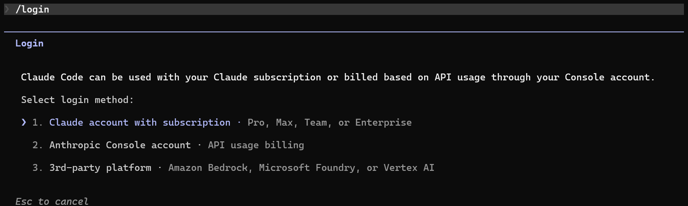

# Claude Code 配置

由anthropic开发的一个AI-powered coding assistant（AI编程助手），一端是经典的对话式交互界面，一端是可以自己通过API调用的大模型。通过这个接口，就可以在非网页（命令行 or vscode 窗口）实现与大模型的对话。


## 一、安装
1. 运行在Node.js环境下，使用npm包管理工具安装
 2. 需要 git 运行环境，见 [Git 配置](Git.md)。
3. 安装cc-switch，划到最底下 [Releases · farion1231/cc-switch · GitHub](https://github.com/farion1231/cc-switch/releases)

```shell
npm install -g @anthropic-ai/claude-code         # 安装命令
claude --version                                 # 检查是否安装成功
```

## 二、问题

### 1. Windows 提示
如果提示 windows 需要git-bash环境，在“系统变量”-“Path”中检查是否有如下两个
替换你实际安装git的文件夹下，我这里是直接安装在D盘。
```
D:\Git\bin            
D:\Git\cmd
```


### 2. 配置文件

在`"C:\Users\<你的用户名>\.claude.json"`配置文件中添加
```json
"hasCompletedOnboarding":true
```
标记用户是否已经完成了 Claude 应用或相关服务的新手引导流程（onboarding）

### 3. 解除上下文限制
```json
    "CLAUDE_CODE_MAX_CONTEXT_TOKENS" : "1000000",
    "CLAUDE_CODE_AUTO_COMPACT_WINDOW" : "1000000",
    "CLAUDE_AUTOCOMPACT_PCT_OVERRIDE" : "90"
```
```
  "autoCompactWindow": 1000000
```

## 三、接入国内模型

### 1. 安装 cc-switch
[Releases · farion1231/cc-switch · GitHub](https://github.com/farion1231/cc-switch/releases)
滑到最底下
[ccswitch 配置](../02-工具/ccswitch.md)
### 2. 配置 API
[MINIMAX API 接入教程](https://platform.minimaxi.com/docs/guides/text-ai-coding-tools)

### 3. 使用 VS Code 插件


## 或者使用订阅

